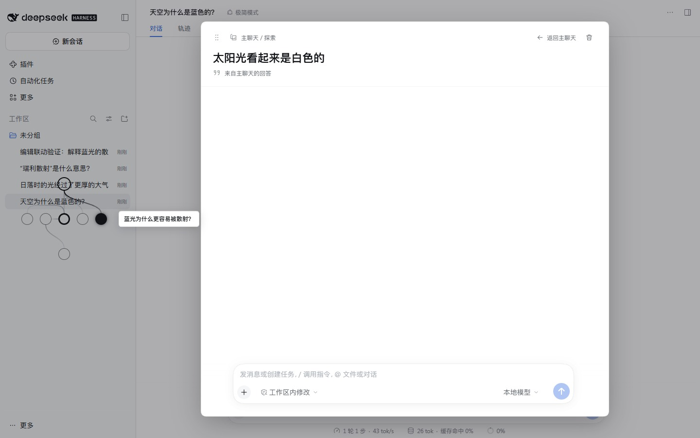

# dsh-btw-explore

DSH 的旁路问答卡片树。在原页面上方打开子卡，沿用 DSH 的对话界面与输入框。可以围绕回答中的一段文字继续提问，也可以从某一轮另开分支。卡片和对话保存在本机，重启 DSH 后可从「探索」回看。



## 用法

在一条聊天消息中选中文字，然后在选区浮层点「探索引用」，就能打开一张卡。卡片沿用原生输入框，可以发送和追问、切换模型、添加附件或调用指令。对话区插件也能使用；依赖主窗口专属区域的插件需要单独适配。

配合 **`dsh-message-toolbar` 1.11.1 或更新版本**，可以在原生子卡里保存回答编辑、切换回答版本和重新生成，整个过程留在同一张卡中。关闭后重开会恢复选中的版本，后续追问使用当前版本的对话和原始引用。使用这些功能时，请同时更新两个插件；工具栏 1.11.0 的保存操作会跳转主窗口。

- **根卡片**：从主聊天划词时，来源固定在选区所在消息；从卡片树新建时，使用主聊天最近的完整文本轮次。
- **子卡**：围绕所选轮次的问题和回答展开。划选了回答中的一段时，只带入该段回答。
- **分支**：继承来源卡的起始上下文，以及从第一轮到指定轮次的问答。后续轮次不会进入分支。
- **卡内追问**：继续当前卡片的对话，不读取其他分支。

在子卡里划词后，可点「探索引用」开下一层，也可点「从此轮分支」保留到该轮为止的上下文。圆点和曲线独立悬浮在右侧，子卡向上生长，同轮分支横向展开；实心点表示当前卡，加粗路径标出来源。树变大后可以拖动或滚动浏览，没有外框和滚动条。悬停或聚焦圆点可以看标题；用方向键浏览，再按 `Enter` 或空格切换。点击圆点可以切换分支或回到父卡，划词开卡、切换与返回都有短程动画。父卡的阅读位置和草稿会保留。点「返回上层」或按 `Esc` 可以逐层返回。顶部「探索」可以浏览全部卡片，选中后点「打开对话」回看。

卡片顶部以轻路径、方向图标和来源摘录帮助定位。系统开启「减少动态效果」时，页面直接切换，保留当前节点和焦点提示。

子卡有自己的对话记录，初始模型和工作区来自主聊天，之后可以独立选择。发过消息的子卡也会出现在 DSH 的「未分组」会话列表。关闭空卡后仍可从树中回来继续。移除卡片会同时移除后代，对话记录仍可从 DSH 会话列表打开。

`0.1.x` 和 `0.2.x` 创建的旧卡仍可查看和追问，也可以划选已完成的回答创建子卡或分支。

## 安装

已在安装版 **DSH 0.2.2-rc.5** 的隔离 Web profile 验证。源码构建需要 Node 24 或更新版本。

在此目录构建并打包：

```powershell
npm install
npm pack
```

在需要使用的 profile 安装本地包，随后重启对应 DSH 实例：

```powershell
$dshPackage = (Resolve-Path -LiteralPath './dsh-btw-explore-0.3.7.tgz').Path.Replace('\', '/')
dsh plugin --profile desktop add "file:$dshPackage"
```

Web profile 将 `desktop` 改为 `web`。本机桌面版若没有将 `dsh` 加入 `PATH`，可以从 PowerShell 调用随桌面版安装的 CLI：

```powershell
$dshInstall = Read-Host '输入 DeepSeek Harness 安装目录'
$dshPackage = (Resolve-Path -LiteralPath './dsh-btw-explore-0.3.7.tgz').Path.Replace('\', '/')
$env:ELECTRON_RUN_AS_NODE = '1'
try {
  & "$dshInstall/DeepSeek Harness.exe" --expose-internals `
    "$dshInstall/resources/app.asar/dsh/node_modules/@deepseek-ai/dsh-desktop-host/lib/cli.js" `
    plugin --profile desktop add "file:$dshPackage"
} finally {
  Remove-Item Env:ELECTRON_RUN_AS_NODE
}
```

## 数据和上下文

卡片关系和来源内容保存在 `$DSH_HOME/btw-explore/cards.sqlite`，未指定 `DSH_HOME` 时为 `~/.dsh/btw-explore/cards.sqlite`。对话记录由 DSH 保存，完整备份需要同时包含 DSH 的会话数据和卡片数据库。

建卡时固定来源文本，后续追问不会改变已有分支的来源。带入的问答文本上限为 24,000 字符，选区引用上限为 4,000 字符，每个主聊天最多 500 张卡。

## 致谢

卡片交互与圆点导航受 [Explore](https://ai.explore.poker/) 启发，感谢 Explore 团队。

## 开发验证

```powershell
npm test
node test/host-smoke.mjs
node test/host-smoke.mjs '--package=./dsh-btw-explore-0.3.7.tgz'
```

测试使用临时 DSH profile 和本地模拟模型，详情见[验证记录](docs/verification.md)。

## 许可证

[MIT](LICENSE)
