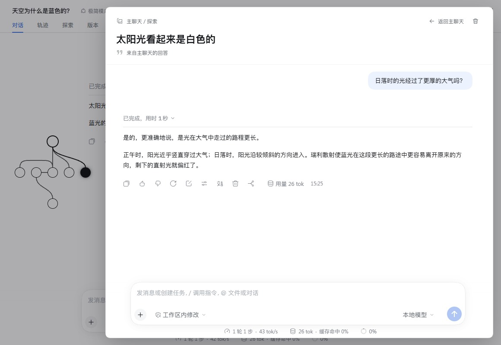

<h1 align="center">dsh-btw-explore</h1>

<p align="center"><strong>在 DeepSeek Harness（DSH）里，划词开子卡，把追问留在自己的分支。</strong></p>

<p align="center">
  <a href="LICENSE"></a>
  <a href="#安装"></a>
</p>

在主聊天上方打开旁路对话，沿用 DSH 的原生界面与输入框。卡片保存在本机，关闭或重启后，也能从左侧圆点树回到原来的分支。



## 安装

在 PowerShell 中从源码安装。需要 Git、Node.js 24 或更新版本，以及已安装的 DSH。以下命令以桌面 profile 为例；Web profile 把 `desktop` 改为 `web`。

```powershell
git clone https://github.com/VicissitudeYW/dsh-btw-explore.git
Set-Location dsh-btw-explore
npm ci
npm run build
$archive = (npm pack --ignore-scripts --json | ConvertFrom-Json).filename
$packagePath = (Resolve-Path -LiteralPath $archive).Path.Replace('\', '/')
dsh plugin --profile desktop add "file:$packagePath"
```

安装后重启对应的 DSH 实例。已克隆仓库的用户可以先更新源码，再从 `npm ci` 开始执行。安装和浏览器交互已在 DSH `0.2.2-rc.5` 中验证。

<details>
<summary>PowerShell 找不到 dsh 命令？</summary>

桌面安装版可调用随 DSH 附带的 CLI。完成打包并得到 `$packagePath` 后，运行：

```powershell
$dshInstall = Read-Host '输入 DeepSeek Harness 的安装路径'
$dshCli = Join-Path $dshInstall 'resources/runtime/cli/bin/dsh.cmd'
& $dshCli plugin --profile desktop add "file:$packagePath"
```

</details>

## 快速开始

1. 在一条 DSH 聊天消息中**选一段文字**。点 **「解释」**，子卡会自动开始解释这段话；点 **「探索」**，子卡会带上引用，等你自己输入问题。
2. 在子卡里继续追问。和主聊天一样，可以切换模型、添加附件或调用指令。
3. 移到**主聊天内容区左缘**唤出圆点树，点击圆点回到已有卡片。也可以打开会话标签栏的 **「探索」**，查看完整卡片树。

| 常用功能 | 怎么操作 |
| --- | --- |
| 追问某个细节 | 在当前子卡内继续发消息，追问留在这张卡里。 |
| 开下一层子卡 | 在子卡里划词，点「解释」或「探索」。若引用的是回答，带入的是选中片段。 |
| 从某一轮另开分支 | 在子卡里划词，点「从此轮分支」。新卡继承起始上下文和截至该轮的问答。 |
| 切换或关闭 | 点击圆点切卡。按 `Esc` 逐层返回；点击最上方圆点或卡片与圆点树之外的背景可回到主聊天。 |

切卡时，前卡左滑退到后方，目标卡移到前面。拖动标题、卡片边缘或留白可以移动卡片。圆点树支持方向键浏览、`Enter` 或空格打开；系统开启「减少动态效果」时直接切卡。

## 常见问题

**重复划词会建出两张卡吗？** 同一条消息里的同一段引用，「解释」和「探索」会打开同一张卡。只有对话为空时，「解释」才会自动提交首问；再次打开已有对话不会重复生成。

**子卡能用其他 DSH 插件吗？** 对话区插件可以用；依赖主窗口专属区域的插件需要适配。使用 [`dsh-message-toolbar`](https://github.com/VicissitudeYW/dsh-message-toolbar) **1.11.1 或更新版本**，可在子卡内保存回答编辑、切换版本和重新生成，重开后会恢复所选版本。`1.11.0` 保存编辑时会跳回主窗口。

**移除卡片会删除原生对话吗？** 不会。移除卡片会把它和后代从探索树移除；发过消息的原生子卡仍可从 DSH 的「未分组」会话列表打开。`0.1.x` 和 `0.2.x` 的旧卡仍可查看、追问和创建分支。

## 数据与配置

- **卡片数据库**：`$DSH_HOME/btw-explore/cards.sqlite`；未配置 `DSH_HOME` 时使用 `~/.dsh/btw-explore/cards.sqlite`。
- **对话记录**：由 DSH 保存。完整备份需要同时保留 DSH 的会话数据和卡片数据库。
- **上下文边界**：建卡时固定来源，后续追问不会改变已有分支的起点。带入的问答文本最多 24,000 字符，选区引用最多 4,000 字符，每个主聊天最多 500 张卡。

## 开发与贡献

```powershell
npm ci
npm test
node test/host-smoke.mjs
```

宿主测试使用临时 DSH profile 和本地模拟模型。参见[设计说明](docs/design.md)与[验证记录](docs/verification.md)。欢迎在 [Issues](https://github.com/VicissitudeYW/dsh-btw-explore/issues) 提供复现步骤、DSH 版本和插件版本。

## 致谢与许可证

卡片交互与圆点导航受 [Explore](https://ai.explore.poker/) 启发，感谢 Explore 团队。

[MIT](LICENSE)
