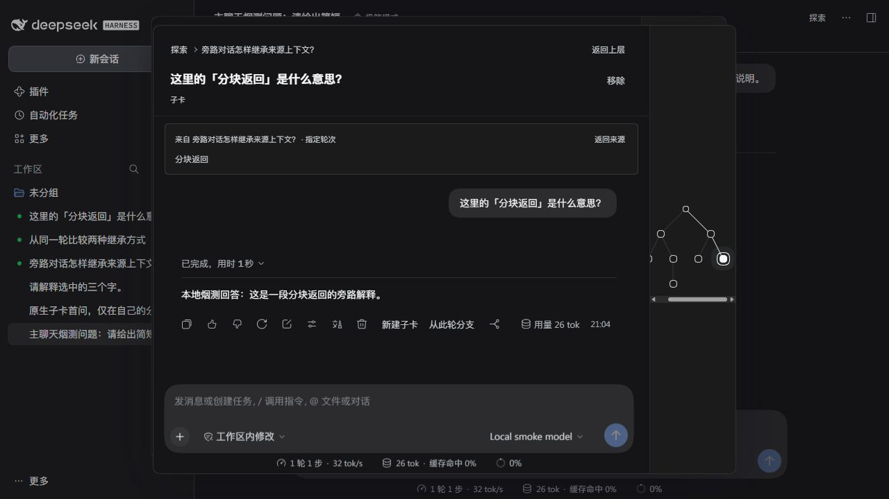

# dsh-btw-explore

DSH 的旁路问答卡片树。新卡在来源聊天上方打开，使用 DSH 的原生对话和输入框。可以从回答中划选内容建立子卡，也可以从指定轮次另开分支。卡片和对话保存在本机，重启 DSH 后可从「探索」回看。



## 使用

在聊天回答下方点「探索」，或划词后点「探索引用」，就能打开一张卡。用原生输入框发送和追问，也可以切换模型、添加附件或调用指令。依赖对话区插槽的插件可随原生界面加载，已验证 `dsh-message-toolbar` 的回答编辑。依赖主窗口独有区域的插件需要单独适配。

- **根卡片**：从当前主聊天的最近完整文本轮次开始；从某条回答进入时，固定到那条消息。
- **子卡**：围绕所选轮次的问题和回答展开。划选了回答中的一段时，只带入该段回答。
- **分支**：继承来源卡的起始上下文，以及从第一轮到指定轮次的问答。后续轮次不会进入分支。
- **卡内追问**：继续当前卡片的对话，不读取其他分支。

完成的回答有「新建子卡」和「从此轮分支」，会在当前卡上再开一层。右侧节点图用连线标出来源，实心点表示当前卡，点其他圆点即可切换。点「返回上层」或按 `Esc` 逐层返回，父卡的阅读位置和草稿会保留。窄窗下子页占满视口，节点图仍可在右侧滚动。顶部「探索」可以浏览全部卡片，选中后点「打开原生对话」回看。

子卡使用独立的普通 DSH 会话，首选模型和工作区来自主会话，后续可以在子卡内独立选择。发过消息的子卡也会出现在 DSH 的「未分组」会话列表。打开新卡时就会在树中保存节点，关闭空卡后仍可回来继续。移除卡片会同时移除后代，已发送的原生聊天仍可从 DSH 会话列表打开。

`0.1.x` 和 `0.2.x` 中创建的旧卡继续用原来的文本问答和预览。你可以从旧卡的已完成回答创建原生子卡或原生分支。

## 安装

已在安装版 **DSH 0.2.2-rc.5** 的隔离 Web profile 验证。源码构建需要 Node 24 或更新版本。

在此目录构建并打包：

```powershell
npm install
npm pack
```

在需要使用的 profile 安装本地包，随后重启对应 DSH 实例：

```powershell
$dshPackage = (Resolve-Path -LiteralPath './dsh-btw-explore-0.3.0.tgz').Path.Replace('\', '/')
dsh plugin --profile desktop add "file:$dshPackage"
```

Web profile 将 `desktop` 改为 `web`。插件发布包没有运行时 npm 依赖，React 与 Markdown 渲染器使用宿主提供的实例。本机桌面版若没有将 `dsh` 加入 `PATH`，可以从 PowerShell 调用随桌面版安装的 CLI：

```powershell
$dshInstall = Read-Host '输入 DeepSeek Harness 安装目录'
$dshPackage = (Resolve-Path -LiteralPath './dsh-btw-explore-0.3.0.tgz').Path.Replace('\', '/')
$env:ELECTRON_RUN_AS_NODE = '1'
try {
  & "$dshInstall/DeepSeek Harness.exe" --expose-internals `
    "$dshInstall/resources/app.asar/dsh/node_modules/@deepseek-ai/dsh-desktop-host/lib/cli.js" `
    plugin --profile desktop add "file:$dshPackage"
} finally {
  Remove-Item Env:ELECTRON_RUN_AS_NODE
}
```

## 数据和上下文

卡片关系和来源快照保存在 `$DSH_HOME/btw-explore/cards.sqlite`，未指定 `DSH_HOME` 时为 `~/.dsh/btw-explore/cards.sqlite`。原生子卡的聊天记录由 DSH 保存，完整备份需要包括 DSH 的会话数据和卡片数据库。主聊天日志提供来源快照，子卡的对话历史独立保存。

建卡时固定来源文本，后续追问不会改变已建分支的快照。继承的文本上限为 24,000 字符，选区引用上限为 4,000 字符。快照只提取问答文本。每个主会话最多 500 张卡。新卡的发送和生成由 DSH 管理，移除原生节点后该节点的来源快照也会从卡片数据库移除。

旧卡的问答同样保存在 SQLite。旧问答支持流式生成和重试，强制退出后未完成轮次最多约 20 秒后显示「中断」。

## 范围

从卡片树跳转到主聊天原文依赖宿主当前能渲染的消息范围。来源轮次不可用时，界面会提示重新选择来源。Explore 的总结卡、自由画布和云同步尚未实现。

本插件是基于公开产品行为和宿主 API 独立实现的作品，未使用 Explore 的私有后端或源码。详细对照见 [调研说明](docs/research.md) 与 [设计记录](docs/design.md)。

## 开发验证

```powershell
npm test
node test/host-smoke.mjs
node test/host-smoke.mjs '--package=./dsh-btw-explore-0.3.0.tgz'
```

单测覆盖来源边界、分支上下文、跨会话隔离、取消和重试、SQLite 恢复和 React 交互。烟测使用独立临时 DSH home 和本地测试模型服务，检查宿主认证、流式问答及进程重启恢复。测试日志在命令打印的临时目录，验收详情见[验证记录](docs/verification.md)。

许可：MIT。
