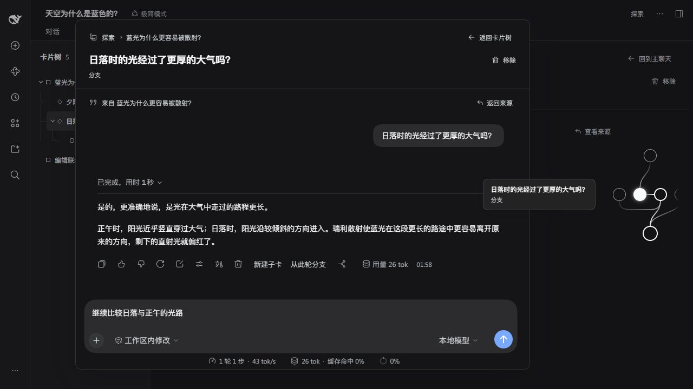

# 0.3.5 二维导航验证

验证日期：2026-11-22。使用 Windows、Node 24、安装版 DSH 0.2.2-rc.5、隔离 Web profile、本地脚本模型，以及配套 dsh-message-toolbar 1.11.1 安装包。

## 代码与安装包

`npm test` 构建客户端并执行 93 项测试，全部通过，零失败、零跳过。导航新增覆盖二维层序、完整画布、宽深树、循环或孤立数据、同层分支避让、双轴滚轮、拖动与取消、单一 Tab 入口、空间方向键、标题提示、无效当前 ID、后台更新与焦点恢复。既有页面栈、原生版本联动和存储回归继续通过。

独立审查发现并关闭三项边界问题，三个回归均先复现失败，再验证修复：

- 删除键盘聚焦节点后，焦点回到最近仍存活的来源。用户已转到输入框时不抢回焦点。
- 手动浏览非当前层后，后台更新以可见节点保持位置，不再锚定视野外的当前卡。
- 在部分裁切的圆点上起拖时，默认鼠标聚焦不再先将节点居中。独立 Edge 事件日志中原先约 52.7px 的首步反跳已消除。

通过 `node test/host-smoke.mjs --package=./dsh-btw-explore-0.3.5.tgz --toolbar-package=<工具栏安装包路径> --serve` 安装到新的临时 profile。22 个检查点通过，包括插件安装、认证、客户端加载、模型流、来源与分支上下文、原生子卡、编辑和重新生成联动，以及实际宿主进程重启恢复。测试以 0 退出，临时宿主和模型服务已停止。

界面检测器对本轮修改返回空结果，`git diff --check` 无空白错误。最终包核对生产文件与已验证包一致，新增展示图和验证文档随包提供。

## 浏览器操作

在最终安装包的真实 DSH 页面点击圆点，打开原生引用子卡，再回到来源卡。当前实心点与页面对应，原生输入框里的未发送草稿「继续比较日落与正午的光路」保留，模型、附件或指令入口和工具栏操作仍可见。对当前圆点拖动 30px，画布 scrollLeft 从 38 变为 68，卡片标题不变，拖动状态正确清除。

独立预览还验证宽树键盘浏览和标题提示。方向键只改变焦点，单一 Tab 入口保持，焦点节点自动进入可视区域。拖动和滚轮保留所有节点原始大小，没有缩小整张树。独立审查另外复核空树恢复后的滚轮监听和真实 Edge 起拖事件。

真实宿主最初将圆点画成圆角方块。DOM 检查确认这是 DSH 全局 `corner-shape: superellipse(1.5)` 对导航元素的影响；导航显式设为 `round` 后，最终宿主计算值为 `superellipse(1)`，24px 普通圆、28px 入口圆均正常。背景透明、边框为零、滚动条隐藏。

| 场景 | 结果 |
| --- | --- |
| 1280 × 720 真实宿主 | 144px 独立导航；浅色和深色均检查；当前点实心、来源路径加粗。 |
| 390 × 844 真实宿主 | 文档宽 390px，卡片宽 298px，导航宽 72px；两者间隔 8px，原生输入框没有被导航遮挡。 |
| 320 × 740 真实宿主 | 文档宽 320px，卡片宽 228px，导航宽 72px；保留原生输入框。 |
| 900 × 360 真实宿主 | 卡片宽 744px，导航宽 108px、高 216px；界面随短窗口收缩。 |
| 600/601px、900/901px 独立预览 | 导航分别采用 72/108px、108/144px；文档未横向溢出。 |

最终宿主截图：

## 证据边界

Explore 正式导航算法来自公开交付资源的静态核对；浏览器现场只确认了首页节点样式，没有验证官网正式工作区的多节点运行。详见[调研记录](navigation-research-0.3.5.md)。Context7 文档通道当次因额度限制不可用，React 布局测量说明改由官方页面核对。

本轮导航位置和状态过渡通过 CSS 及回归测试核对，既有页面动画回归覆盖切卡、打断、迟到完成、划词来源几何及减少动态效果。浏览器检查了切卡结果和覆盖父卡的缩放位移，没有测量帧率；拓扑改变时的曲线插值取决于浏览器与路径命令兼容性。

树列表一次鼠标选择未改变选中项，随后通过 Enter 正常打开目标；该次列表操作没有计为通过。圆点导航的鼠标切卡与拖动单独验证。浏览器日志中的重连警告均指向已主动停止的中间宿主，最终宿主没有对应警告或错误。

测试使用临时数据和本地脚本模型，覆盖协议、上下文和界面接线，不代表真实模型回答质量。用户桌面 profile、真实模型提供商、物理触屏、系统屏幕阅读器及非 Chromium 浏览器没有参与本次验收。
